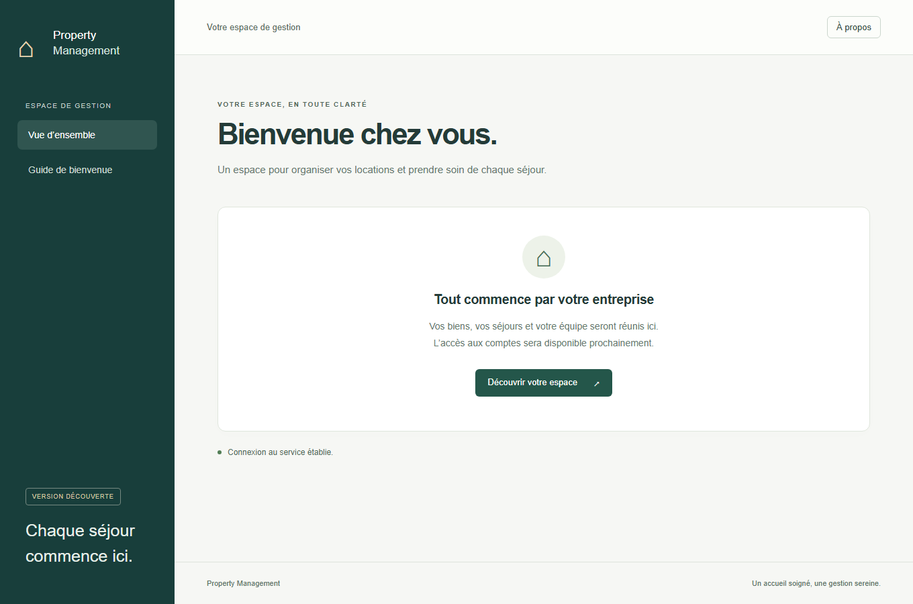

# AI-Powered Property Management SaaS

Plateforme de gestion de locations de courte durée pour plusieurs entreprises indépendantes : biens et unités, voyageurs, réservations, paiements de test, ménage, maintenance et reporting. L'assistant IA est une extension V3, sans dépendance du MVP.

**État au 11 novembre 2026 : P01 et P02 fusionnées, P03 en cours.** FastAPI, React/TypeScript, Alembic et les processus outbox/worker sont disponibles. Compose démarre dix processus persistants et un job de migration. La PR P03 ajoute profils, sessions persistantes révocables et routes Auth protégées par cookies/CSRF/Origin/débit. La récupération de compte, les organisations et les écrans Auth restent à livrer. Aucun déploiement AWS n'est réalisé. Voir les suivis [P01](docs/progress/phase-01.md), [P02](docs/progress/phase-02.md) et [P03](docs/progress/phase-03.md).

[Dépôt GitHub](https://github.com/ABDOUUisHERE/ai-property-management-saas) · [PR P01 fusionnée](https://github.com/ABDOUUisHERE/ai-property-management-saas/pull/10) · [CI P01 après fusion](https://github.com/ABDOUUisHERE/ai-property-management-saas/actions/runs/42842746766)

## Référence et documents

- [Cahier des charges v1.0](property_management_saas_cahier_des_charges.md) : référence fonctionnelle et technique, conservée sans modification.
- [Analyse et traçabilité](docs/architecture/analysis.md) : périmètre, exigences, critères de recette et correspondance avec le backlog.
- [Architecture](docs/architecture/README.md) : système, modèle métier, API, frontend et qualité.
- [Décisions validées, paramètres ouverts et risques](docs/architecture/risks-decisions.md).
- [Six ADRs acceptés](docs/adr/README.md) : l'acceptation du choix AWS ne vaut pas autorisation de déployer.
- [Backlog](docs/backlog/README.md) : Epic → Feature → User Story → Technical Task.
- [Roadmap et conditions de sortie](docs/roadmap.md).
- [Organisation GitHub proposée](docs/github-workflow.md).
- [Publication GitHub et limites de configuration](docs/github-publication-plan.md).
- [Vocabulaire métier](GLOSSARY.md) et [règles Codex](AGENTS.md).

## Architecture retenue

Monolithe modulaire FastAPI, frontend React/TypeScript et contrats `/api/v1`. PostgreSQL porte les transactions et contraintes d'intégrité. Supabase Auth est l'autorité d'identité retenue ; son instance locale est vérifiée, sa façade applicative arrive en P03. Redis transporte les tâches ; PostgreSQL conserve l'outbox et les reçus durables. Le stockage S3 est privé. Stripe sera intégré exclusivement en mode test.

Le déploiement AWS est optionnel et conditionné à la disponibilité des accès, du budget et à une validation explicite. Les intégrations de canaux V2 utilisent d'abord un simulateur ; aucune intégration officielle Airbnb/Booking.com n'est revendiquée.

## Démarrer l'application locale

Prérequis : Git, uv et Docker Desktop/Engine avec Compose et moteur Linux actif. Node 24/npm 11 sont nécessaires pour développer le frontend hors Docker. Depuis la racine :

```powershell
uv sync --locked
uv run python scripts/dev.py init
uv run python scripts/dev.py up
uv sync --project backend --locked
uv run python scripts/application.py smoke
uv run python scripts/dev.py smoke
```

`init` génère les credentials locaux dans `.env`, ignoré par Git, et préserve les valeurs existantes. `up` lance Compose et attend les sondes. Après l'initialisation, `docker compose up --build` est également utilisable. Le [runbook](docs/runbooks/local-development.md) décrit les ports, l'arrêt, la reprise, les contrôles et les limites.

Interface : `http://127.0.0.1:18173`. Documentation API : `http://127.0.0.1:18000/api/v1/docs`. Mailpit : `http://127.0.0.1:18025`. Auth : `http://127.0.0.1:19999/health`. Aucun compte cloud requis ; les ports publiés sont liés à la boucle locale. Le [runbook applicatif](docs/runbooks/application-development.md) décrit migrations, tests et outbox ; les [contrats API](docs/api/README.md) décrivent la génération des types frontend.



## Validation et limites actuelles

```powershell
uv run ruff check .
uv run ruff format --check .
uv run python scripts/check_repository.py
uv run pytest
uv run python scripts/scan_secrets.py
uv run python scripts/application.py test --broker-recovery
```

Validation locale P02 : **16 tests d'outillage, 15 tests backend, 9 tests frontend et 3 tests navigateur** réussis ; lint, format, mypy strict, TypeScript, build, audit npm et scan de secrets vérifiés. Les tests backend utilisent une base PostgreSQL jetable et vérifient migrations, contexte/RLS de l'outbox, rollback, consommation concurrente et récupération après perte réelle d'un message Redis. Les tests navigateur couvrent clavier, dialogue, affichage mobile et audits axe sur les écrans livrés.

Dans `backend/` : `uv run mypy` et `uv run pytest -m 'not integration'`. Dans `frontend/` : `npm ci`, `npm run lint`, `npm run format:check`, `npm run check:api`, `npm run typecheck`, `npm test`, `npm run build`, puis `npx playwright install chromium --only-shell` et `npm run test:e2e` avec Compose lancé.

La [PR P02 #21](https://github.com/ABDOUUisHERE/ai-property-management-saas/pull/21) est fusionnée sur `04726fe`, après [CI verte sur le HEAD corrigé](https://github.com/ABDOUUisHERE/ai-property-management-saas/actions/runs/43010940075) : **17 tests d'outillage, 16 backend, 9 frontend et 3 navigateur**. Le premier incrément P03 est suivi dans la [PR #37](https://github.com/ABDOUUisHERE/ai-property-management-saas/pull/37). Les parcours E2E métier auth/réservation/opérations, le seed métier et Stripe seront ajoutés avec leurs fonctionnalités. La protection multi-tenant P02 concerne les primitives outbox ; elle ne prouve pas encore l'isolation des futures tables métier.

## Prochaine étape

Livrer les tâches T020–T022 en revue dans la PR #37, puis poursuivre P03 autorisée : récupération de compte, organisations, isolation et écrans Auth. Les [quinze Issues P03](https://github.com/ABDOUUisHERE/ai-property-management-saas/milestone/3) restent ouvertes tant que leur livraison n'est pas fusionnée. Huit Issues P01 sont clôturées avec preuves ; T003/#3 reste ouverte pour le choix de licence. La configuration distante actuelle est conservée ; aucune dépense AWS n'est engagée.
