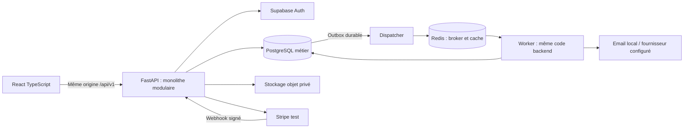

# Système et frontières

## Vue d'ensemble proposée

L'API et le worker sont des processus du même monolithe, livrés depuis le même code et les mêmes contrats, pas des microservices. FastAPI constitue l'unique API métier ; le navigateur n'accède ni directement aux tables via PostgREST, ni au rôle administrateur Supabase. PostgreSQL est la source de vérité des disponibilités, paiements locaux et événements durables. Redis peut être perdu sans perdre un engagement confirmé ou un événement métier.

## Modules, propriété et dépendances

Dans la table, « dépend de » signifie que le module consommateur utilise un contrat explicite du fournisseur. Les modèles ORM privés et services internes ne sont pas une API publique. Les projections de lecture peuvent effectuer des jointures SQL documentées sans modifier les tables étrangères.

| Module | Possède / responsabilité | Dépend de |
| --- | --- | --- |
| identity | Lien profil utilisateur ↔ sujet Auth, sessions de façade, adaptation Supabase | Port Auth externe |
| organizations | Organisations, memberships, invitations, politiques de rôle | identity ; audit via port |
| properties | Propriétés, unités, équipements, métadonnées/photos | organizations ; port stockage |
| guests | Fiches voyageurs et cycle de données personnelles | organizations |
| pricing | Calcul de devis, détails et règles tarifaires | Contrat de lecture properties ; règles locales |
| availability | Calendrier, blocages manuels, verrou d'unité et lecture d'occupation | properties ; `InventoryReadPort` |
| reservations | États du séjour, création, confirmation, annulation, arrivée/départ, idempotence | properties, guests, pricing, availability |
| payments | Tentatives Checkout, paiements, événements Stripe, remboursements et rapprochement | Contrats de commande/lecture reservations ; port Stripe |
| operations | Tâches, configuration ménage, tickets de maintenance | Événements reservations ; properties ; membres autorisés |
| notifications | Messages, tentatives d'envoi et échecs | Événements métier et port email |
| reporting | Projections et exports en lecture seule | Données autorisées properties, reservations, payments, operations |
| audit | Événements sensibles append-only | Contrat d'acteur/tenant ; pas de services métier |

Le bootstrap construit les adapters et injecte les dépendances ; aucun singleton global de session SQL. Un `TenantContext`, une unité de travail et une session SQL existent par cas d'usage. Les cas simples peuvent regrouper service et règles ; les réservations/paiements méritent un domaine séparé des adapters. Pas de repository générique universel, bus distribué ni abstraction pour chaque fonction.

`InventoryReadPort` expose les séjours bloquants d'une unité. Son adapter SQL de lecture est câblé au bootstrap ; availability n'importe pas le service reservations. Les réservations consomment le protocole d'inventaire d'availability. Cela évite la boucle reservations → availability → reservations. Reporting utilise des projections SQL explicites plutôt que des appels HTTP internes.

Les événements de réservation déclenchent operations et notifications par outbox ; reservations ne dépend pas de ces consommateurs. payments appelle une commande idempotente du module reservations pour confirmer ; reservations ne consulte pas le service payments. Les contraintes d'éligibilité au paiement sont transmises par les contrats, et non par une importation circulaire.

## Authentification et contexte d'organisation

Proposition D01 : Supabase Auth détient les identifiants et les sessions ; `users` n'est qu'un profil lié par sujet immuable, sans second mot de passe. FastAPI expose les endpoints attendus comme façade. Le backend vérifie signature et claims du jeton via une bibliothèque éprouvée et les clés attendues ; aucune confiance dans un décodage sans vérification. [Source : JWT Supabase](https://supabase.com/docs/guides/auth/jwts).

Choix de transport proposé : façade de session même origine avec cookies Secure/HttpOnly/SameSite en HTTPS, CSRF et contrôle Origin sur mutations, y compris login/logout. La session fournisseur comporte access/refresh et expiration ; vérifier un JWT ne suffit pas à définir un comportement de déconnexion. [Source : sessions Supabase](https://supabase.com/docs/guides/auth/sessions).

Notre façade proposée utilise un identifiant de session opaque aléatoire dans le cookie ; seul son hash est stocké dans `auth_sessions`. Les tokens fournisseur restent côté serveur, chiffrés au repos avec une clé séparée des données ; pas de refresh token dans localStorage. Cette session est une représentation locale révocable de la session Supabase, pas une deuxième autorité de credentials. Logout invalide immédiatement la session locale et demande la déconnexion fournisseur. La rotation utilise une coordination persistante par session et un contrôle de version, sans appel fournisseur dans une transaction d'inventaire. T021/T022 doivent spécifier et prouver renouvellement concurrent, timeout ambigu, durée maximale, révocation et rotation de la clé de chiffrement. Cookies moins stricts uniquement dans un profil local explicitement isolé, ou HTTPS local ; jamais comme repli silencieux de production.

Un identifiant d'organisation sélectionné par le client est un **sélecteur non fiable**. Le serveur authentifie le sujet puis vérifie sa membership active et ses permissions actuelles ; lui seul construit le `TenantContext`. Les JWT ne fixent pas durablement les rôles d'organisation. En cas de retrait d'un membre, la prochaine requête métier est refusée. Ne pas stocker un unique tenant actif global à l'utilisateur : deux onglets peuvent utiliser deux organisations différentes.

## Isolation PostgreSQL

Proposition D02 : schéma partagé, `organization_id` obligatoire, filtres applicatifs explicites et RLS en défense supplémentaire. Le rôle d'exécution n'est ni propriétaire des tables, ni superuser, ni `BYPASSRLS`. Rôle de migration séparé ; RLS forcé sur les tables concernées. `USING` et `WITH CHECK` protègent lectures et écritures. Le contexte est posé avec une portée transactionnelle (`SET LOCAL`/`set_config(..., true)` paramétré), absent = refus ; il ne survit pas au retour de connexion au pool. Les exemptions PostgreSQL rendent indispensable le test avec le vrai rôle applicatif. [Source : PostgreSQL RLS](https://www.postgresql.org/docs/current/ddl-rowsecurity.html).

L'inscription, `/me`, la création d'organisation et la résolution de membership précèdent parfois l'existence du tenant actif. Des politiques ciblées sur l'acteur autorisent uniquement ses propres memberships et la création atomique organisation + premier owner. Cette voie de bootstrap n'utilise pas un bypass général. Les invitations sont consommées une seule fois, par une identité correspondant à l'adresse vérifiée.

Caches : clés incluant organisation, autorisations pertinentes et version ; Query keys React incluant le tenant. Jobs : tenant issu de l'événement durable déjà autorisé, revalidé lors de l'exécution selon sa nature. Stockage : objets privés, clés internes par organisation et autorisation avant émission d'URL signée courte. Webhooks : tenant déduit de la correspondance paiement locale, après signature et rapprochement, jamais d'un header client.

Le résolveur technique Stripe peut uniquement retrouver une correspondance exacte `(compte, mode, identifiant fournisseur)` et obtenir l'organisation liée ; ensuite le traitement métier utilise le rôle tenant ordinaire. Cette capacité et l'inbox non résolue sont séparées de l'accès runtime général : droits minimaux, interface de lookup bornée, pas de lecture globale des réservations ni de bypass RLS partagé. Tester cette exception en T063/T065, y compris l'impossibilité de consulter une autre table via ce rôle.

Un job demandé par un utilisateur (par exemple un export) revalide ses droits courants à l'exécution. Les obligations système déjà engagées (rapprocher un paiement ou générer le ménage) utilisent un principal système borné à l'organisation, pour rester exécutables après le retrait de l'acteur initial. Aucun job n'accepte un tenant arbitraire depuis un payload client non autorisé.

RLS ne remplace pas RBAC ni ne protège d'un backend entièrement compromis possédant les droits de changer le contexte. Les tâches admin, sauvegardes et migrations restent des capacités séparées.

## Cohérence, événements et erreurs

La mutation, l'audit sensible et l'insertion outbox partagent la transaction PostgreSQL. Le dispatcher republie les éléments non acquittés ; une publication répétée est normale. Chaque consommateur utilise une clé métier unique et marque son résultat dans sa transaction. Les données métier restent récupérables après perte de Redis. Proposition : Celery avec Redis, délais, retry borné, backoff/jitter et file d'échecs persistée en PostgreSQL. Aucun engagement « exactly once » sur le réseau.

Ces primitives apparaissent en phase 2, leur recette approfondie de crash en phase 6, puis les consommateurs opérations en phase 7. Un adapter email minimal sert déjà aux invitations en phase 3 ; le module notifications le réutilise pour les messages opérationnels en phase 7. Les expirations d'options en phase 5 utilisent déjà un worker ; elles ne sont pas reportées à la phase opérations.

Les exceptions métier stables sont converties centralement en erreurs HTTP normalisées. Un conflit d'exclusion devient 409 après rollback complet ; une erreur inattendue retourne un identifiant de corrélation, sans SQL ni secret. Logs JSON sur stdout et propagation d'un identifiant de requête vers outbox/jobs ; audit métier distinct des logs techniques.

## Local et cible AWS

Local proposé : frontend, API, PostgreSQL métier, Redis, worker/dispatcher, stockage S3-compatible et Mailpit ; Auth local dérivé d'une composition officielle Supabase épinglée, avec dépendances et secrets de développement isolés. La commande racine doit orchestrer l'ensemble : ne pas imposer silencieusement `supabase start` en plus de `docker compose up --build`. Les recettes et le seed créent les utilisateurs via Auth, jamais par insertion de mots de passe dans la base métier. La faisabilité et le coût mémoire sont à prouver en T005–T008. Le guide officiel distingue CLI locale et déploiement Docker ; les services inutiles peuvent être retirés. [Source : Docker Supabase](https://supabase.com/docs/guides/self-hosting/docker).

Production optionnelle proposée D09 : frontend statique S3/CloudFront, routage même origine `/api/*` vers ALB/ECS Fargate ; API et worker indépendamment dimensionnés, RDS PostgreSQL, Redis privé géré, objets S3 privés, secrets gérés et logs CloudWatch. [Fargate](https://docs.aws.amazon.com/AmazonECS/latest/developerguide/AWS_Fargate.html) fournit le modèle de tâches/services conteneurisés ; la topologie est notre proposition. Vérifier [extensions et permissions RDS](https://docs.aws.amazon.com/AmazonRDS/latest/UserGuide/Appendix.PostgreSQL.CommonDBATasks.Extensions.html) sur la version choisie. Supabase Auth géré séparément avec région cohérente. La politique de cache du proxy ne cache pas les réponses privées et transmet les cookies requis. Accès DB privés, TLS, sauvegardes et restauration avant démonstration publique. App Runner reste une alternative si l'exploitation d'un worker séparé et le coût total sont démontrés plus simples.
